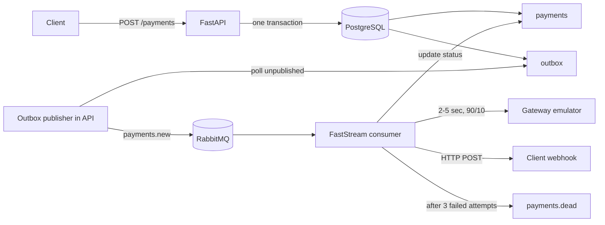

# Async Payment Processing Service

Тестовый микросервис асинхронной обработки платежей на **FastAPI + PostgreSQL + RabbitMQ (FastStream)**.

## Что реализовано

- `POST /api/v1/payments` — создание платежа, `202 Accepted`.
- `GET /api/v1/payments/{payment_id}` — получение состояния платежа.
- Обязательные заголовки `X-API-Key` и `Idempotency-Key`.
- Идемпотентное создание платежа через уникальный `idempotency_key`.
- PostgreSQL + SQLAlchemy 2.0 в async-режиме.
- Alembic-миграции (`payments`, `outbox`).
- Transactional Outbox: платеж и событие создаются атомарно в одной DB-транзакции.
- Фоновая публикация outbox-событий в RabbitMQ `payments.new`.
- Durable `payments.new` и `payments.dead` объявляются до запуска outbox publisher.
- Один FastStream consumer, который эмулирует платёжный шлюз 2–5 секунд с результатом 90/10.
- Webhook после обработки платежа.
- 3 попытки обработки с экспоненциальной задержкой.
- Dead Letter Queue `payments.dead` после исчерпания попыток.
- Защита consumer от повторной доставки: уже проведённый платёж не проводится повторно, успешно доставленный webhook не отправляется повторно.
- Docker Compose: PostgreSQL, RabbitMQ, API, consumer.
- Healthcheck, базовые unit-тесты и GitHub Actions CI.

## Архитектура



### Почему Outbox

API не публикует сообщение в RabbitMQ напрямую после `COMMIT`. Вместо этого `payment` и `outbox` записываются в одной транзакции. После коммита publisher забирает неопубликованные события через `FOR UPDATE SKIP LOCKED`, публикует persistent message в RabbitMQ и только затем ставит `published_at`.

Если приложение упадёт после публикации в RabbitMQ, но до фиксации `published_at`, событие может быть опубликовано повторно. Это ожидаемая семантика **at-least-once**, поэтому consumer сделан идемпотентным.

## Быстрый запуск

Требования: Docker + Docker Compose.

```bash
cp .env.example .env
docker compose up --build
```

После запуска:

- API: `http://localhost:8000`
- Swagger: `http://localhost:8000/docs`
- RabbitMQ UI: `http://localhost:15672` (`guest` / `guest`)

Миграции автоматически выполняются перед запуском API.

## Пример создания платежа

```bash
curl -i -X POST 'http://localhost:8000/api/v1/payments' \
  -H 'Content-Type: application/json' \
  -H 'X-API-Key: test-secret-api-key' \
  -H 'Idempotency-Key: order-42-attempt-1' \
  -d '{
    "amount": "199.90",
    "currency": "RUB",
    "description": "Order #42",
    "metadata": {"order_id": 42},
    "webhook_url": "https://webhook.site/replace-with-your-url"
  }'
```

Ответ:

```json
{
  "payment_id": "5b6f5f3d-2ac1-4a1e-a5fd-b116f8eaa3e6",
  "status": "pending",
  "created_at": "2026-10-05T08:00:00Z"
}
```

Повтор того же запроса с тем же `Idempotency-Key` вернёт тот же платёж. Дополнительно ответ содержит `X-Idempotent-Replay: true`.

## Получение платежа

```bash
curl 'http://localhost:8000/api/v1/payments/<payment_id>' \
  -H 'X-API-Key: test-secret-api-key'
```

## Webhook

Consumer отправляет `POST` на `webhook_url`:

```json
{
  "payment_id": "5b6f5f3d-2ac1-4a1e-a5fd-b116f8eaa3e6",
  "status": "succeeded",
  "amount": "199.90",
  "currency": "RUB",
  "processed_at": "2026-10-05T08:00:04Z"
}
```

Если обработка (включая webhook) завершается с технической ошибкой, consumer делает максимум 3 попытки. Задержка вычисляется как `base_delay * 2^(attempt-1)`: при base=1 это 1s, 2s между попытками. После третьей ошибки сообщение reject-ится RabbitMQ и попадает в `payments.dead`.

> `failed` от эмулятора платёжного шлюза — это нормальный бизнес-результат, а не техническая ошибка. Такой платёж получает статус `failed`, после чего webhook всё равно отправляется.

## Идемпотентность

### API

`payments.idempotency_key` имеет UNIQUE constraint. Сначала сервис ищет существующий платёж, а constraint закрывает race condition между параллельными одинаковыми запросами.

### Consumer

RabbitMQ/Outbox обеспечивают at-least-once, поэтому сообщение может прийти повторно. Consumer:

1. берёт платёж `FOR UPDATE`;
2. вызывает шлюз только если статус `pending`;
3. сохраняет финальный статус и `processed_at`;
4. webhook отправляет только если `webhook_delivered_at IS NULL`.

## Очереди

- `payments.new` — основная durable очередь.
- `payments.dead` — durable DLQ.
- Основная очередь настроена с `x-dead-letter-exchange=""` и `x-dead-letter-routing-key="payments.dead"`; используется стандартный direct exchange RabbitMQ.

## Переменные окружения

См. `.env.example`.

| Переменная | Назначение |
|---|---|
| `API_KEY` | статический API key |
| `DATABASE_URL` | async SQLAlchemy DSN |
| `RABBITMQ_URL` | RabbitMQ DSN |
| `OUTBOX_POLL_INTERVAL` | интервал polling outbox |
| `OUTBOX_BATCH_SIZE` | размер пачки outbox |
| `WEBHOOK_TIMEOUT` | timeout webhook |
| `PROCESSING_MAX_ATTEMPTS` | число попыток consumer |
| `PROCESSING_RETRY_BASE_DELAY` | база exponential backoff |

## Локальные проверки

```bash
python -m venv .venv
source .venv/bin/activate  # Windows: .venv\Scripts\activate
pip install -r requirements-dev.txt
ruff check .
pytest -q
```

## Проверка Outbox и DLQ

Outbox:

```sql
SELECT id, event_type, attempts, published_at, last_error
FROM outbox
ORDER BY created_at DESC;
```

DLQ удобно посмотреть в RabbitMQ Management UI: `Queues and Streams -> payments.dead`.

Для проверки DLQ можно указать недоступный `webhook_url`. Платёж обработается, webhook трижды завершится технической ошибкой, после чего исходное сообщение окажется в `payments.dead`.

## Структура

```text
app/
├── api/                 # HTTP endpoints + auth dependency
├── core/                # settings, logging
├── db/                  # async engine/session, declarative base
├── messaging/           # broker, queue topology, consumer, outbox publisher
├── models/              # SQLAlchemy models
├── repositories/        # DB access
├── schemas/             # Pydantic v2 contracts
└── services/            # payment use-case, gateway, webhook, processor
alembic/
tests/
```

## Design notes / trade-offs

- Outbox publisher работает внутри API-process, чтобы docker-compose соответствовал минимальному набору `postgres + rabbitmq + api + consumer`. Для горизонтального масштабирования API используется `FOR UPDATE SKIP LOCKED`, поэтому несколько publisher-loop могут безопасно разбирать разные outbox rows.
- Во время имитации gateway consumer держит row lock платежа. Для тестового задания это делает duplicate processing очевидно корректным. В production при долгом внешнем gateway лучше вводить отдельное состояние/lease и не держать DB transaction во время сетевого I/O.
- Доставка webhook имеет at-least-once природу до записи `webhook_delivered_at`. Получателю webhook всё равно рекомендуется быть идемпотентным по `payment_id`.

## Git

```bash
git init
git add .
git commit -m "Implement async payment processing service"
git branch -M main
git remote add origin https://github.com/<username>/payment-processing-service.git
git push -u origin main
```

После этого работодателю можно отправить ссылку вида:

```text
https://github.com/<username>/payment-processing-service
```
